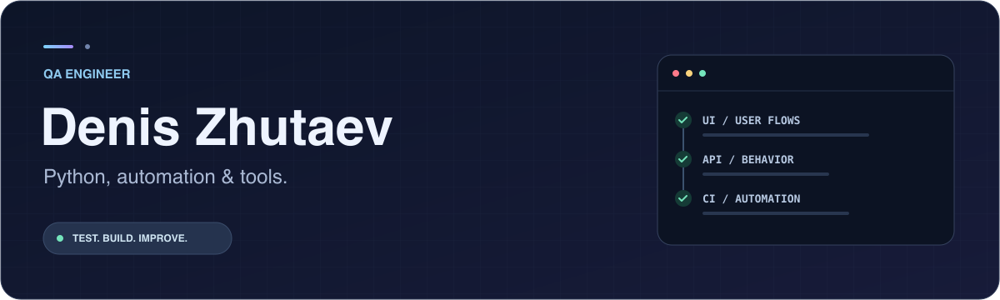

  

  <a href="#проекты">Проекты</a> ·
  <a href="#инструменты">Инструменты</a> ·
  <a href="https://github.com/DenisZhutaev?tab=repositories">Все репозитории</a>

## Привет, я Денис

Занимаюсь тестированием и пишу на Python. Проверяю требования, пользовательские сценарии и API, автоматизирую повторяющиеся проверки. Ещё делаю небольшие приложения, которые решают повседневные задачи.

Здесь собраны мои проекты по автоматизации, учебные работы и собственные инструменты. Сейчас развиваю **Happ Monitor**: приложение для macOS, которое показывает состояние подключения прямо в строке меню.

## Проекты

<table>
<tr>
<td width="50%" valign="top">
<h3><a href="https://github.com/DenisZhutaev/happ-monitor">Happ Monitor</a></h3>

<strong>Приложение для macOS</strong>

Контроль подключения, автоматическое восстановление и выбор сервера. Компактный HM в строке меню, настройки стран и история событий.

<code>Swift</code> <code>AppKit</code> <code>GitHub Actions</code>

<a href="https://github.com/DenisZhutaev/happ-monitor#меню-и-настройки-в-действии">Посмотреть приложение →</a>
</td>
<td width="50%" valign="top">
<h3><a href="https://github.com/DenisZhutaev/qa-auto-engineer-python-project-314">Task Manager · UI tests</a></h3>

<strong>Автоматизация пользовательских сценариев</strong>

Проверки входа, пользователей, статусов, меток и задач. Отдельные наборы для smoke-проверок и основных функций.

<code>Python</code> <code>pytest</code> <code>Selenium</code>

<a href="https://github.com/DenisZhutaev/qa-auto-engineer-python-project-314">Открыть тесты →</a>
</td>
</tr>
<tr>
<td width="50%" valign="top">
<h3><a href="https://github.com/DenisZhutaev/Final_work_skillfactory_QA">Проверка авторизации</a></h3>

<strong>Учебный QA-проект</strong>

Анализ требований, тест-кейсы и автоматические проверки интерфейса авторизации. Применение техник тест-дизайна и документация проверок.

<code>Python</code> <code>pytest</code> <code>Selenium</code>

<a href="https://github.com/DenisZhutaev/Final_work_skillfactory_QA">Изучить проект →</a>
</td>
<td width="50%" valign="top">
<h3>Ещё в репозиториях</h3>

Эксперименты с Python, Telegram-боты и учебные проекты.

<a href="https://github.com/DenisZhutaev/Telegram_currency_converter_bot">Конвертер валют</a> 
<a href="https://github.com/DenisZhutaev/Telegram_password_generating_bot">Генератор паролей</a>

<a href="https://github.com/DenisZhutaev?tab=repositories">Все публичные проекты →</a>
</td>
</tr>
</table>

## Инструменты

| Направление | С чем работаю |
|:---|:---|
| Автоматизация | Python · pytest · Selenium · GitHub Actions |
| Проверки и диагностика | Postman · DevTools · Git |
| Требования и интерфейсы | Jira · Miro · Figma |
| Приложения для macOS | Swift · AppKit |

## Как подхожу к работе

Сначала разбираюсь в требованиях и проверяю поведение приложения. Затем описываю сценарии, воспроизвожу ошибки и собираю доказательства. Повторяющиеся проверки переношу в автоматизацию.

Мне интересно соединять тестирование и разработку: находить слабые места продукта и делать инструменты, которые помогают с ними работать.

---

  Тестирование, автоматизация и инструменты для повседневных задач. 
  <a href="https://github.com/DenisZhutaev?tab=repositories"><strong>Посмотреть мои проекты →</strong></a>

